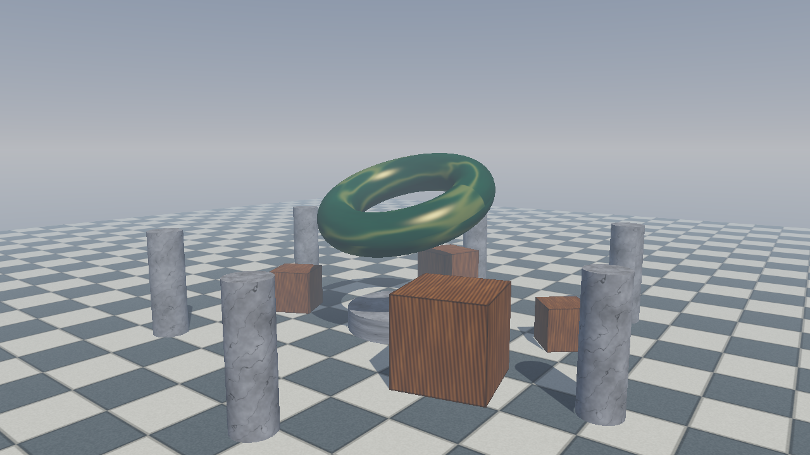

# gl_mini_renderer

一个使用 **C++17 + OpenGL 3.3 Core** 编写的迷你实时 3D 渲染器：包含 OBJ 模型加载、纹理、Blinn-Phong 光照、方向光阴影映射、程序生成 HDR 天空盒、HDR 后处理和自由摄像机。项目不依赖游戏引擎，所有第三方库与默认资产均已本地化，可离线构建与运行。



> 截图由最终 Release 构建通过 `--screenshot` 回读默认帧缓冲生成，分辨率 1280×720，不是外部图片或手工拼贴。

## 功能清单（P0）

| # | 要求 | 实现与验证 |
|---|------|------------|
| 1 | CMake 一键构建，生成 `gl_mini_renderer` | CMake ≥ 3.16、C++17；GLFW/GLAD/GLM/stb/tinyobjloader 全部 vendored。已从空 `build/` 目录完成 Release 构建 |
| 2 | 1280×720、OpenGL 3.3 Core、VSync、ESC 退出 | GLFW 窗口 + Core Profile；默认 `glfwSwapInterval(1)`；ESC 经 GLFW 回调/轮询退出，已实际验证 |
| 3 | 自由摄像机 | WASD 前后左右、Space/Ctrl 升降、Shift 加速、鼠标视角、滚轮 FOV 缩放；pitch 限制 ±89°；WASD、鼠标、滚轮均已实际验证 |
| 4 | 默认 3D 场景（地面 + 带纹理模型） | 60×60 棋盘地面、石质基座、6 根石柱、4 个木箱、旋转玉质圆环；圆环由 `assets/models/torus.obj` 加载 |
| 5 | Blinn-Phong 光照 | 方向光 + 环境光 + 漫反射 + 半程向量镜面高光；法线矩阵为 `transpose(inverse(mat3(model)))` |
| 6 | 方向光阴影（深度 FBO + 3×3 PCF，F3 开关） | 2048² `DEPTH_COMPONENT24` 阴影贴图、`sampler2DShadow`、正交光空间矩阵、3×3 PCF、法线相关 bias、front-face culling + polygon offset；F3 已实际验证 |
| 7 | 天空盒，摄像机移动不位移 | 代码生成 6 面 256² `RGBA16F` 渐变 cubemap（含太阳光晕）；view 仅保留旋转，裁剪坐标使用 `xyww` |
| 8 | FBO 后处理：正常/灰度/反色，F1 循环 | `RGBA16F` 场景 FBO + 深度 RBO；tonemap + gamma 2.2；F1 循环 normal → grayscale → invert，已实际验证 |
| 9 | FPS 显示、F2 线框 | 窗口标题每 0.5 s 更新 FPS、阴影/线框/后处理状态与 FOV；F2 切换 `glPolygonMode`，已实际验证 |
| 10 | README | 本文件，包含构建、运行、操作、功能、验证记录与已知限制 |

附加实现：HDR 曝光与色调映射、距离雾、OBJ 法线重算、程序生成材质、自动截图、`--frames` 冒烟测试、命令行初始渲染状态。

其他渲染状态截图：

| 灰度后处理 | 反色后处理 | 线框 | 关闭阴影 |
|---|---|---|---|
| [grayscale](docs/screenshot_grayscale.png) | [invert](docs/screenshot_invert.png) | [wireframe](docs/screenshot_wireframe.png) | [no shadow](docs/screenshot_noshadow.png) |

## 构建

### 依赖

所有依赖均已放入 `third_party/`，构建阶段不需要联网：

- GLFW 3.4（源码）
- GLAD（glad2 2.0.8 生成的 OpenGL 3.3 Core loader）
- GLM 1.0.1（头文件）
- stb_image 2.30 / stb_image_write 1.16（头文件）
- tinyobjloader 单头文件（MIT）

系统只需要 C++17 编译器、CMake ≥ 3.16 与 OpenGL 开发/运行环境。

### Linux / macOS

```bash
cmake -S . -B build -DCMAKE_BUILD_TYPE=Release
cmake --build build -j
```

Linux 若缺少图形开发包，可按发行版安装，例如 Debian/Ubuntu：

```bash
sudo apt install build-essential cmake libgl1-mesa-dev xorg-dev
```

macOS 需要 Xcode Command Line Tools；代码中已为 macOS 设置 `GLFW_OPENGL_FORWARD_COMPAT`。

### Windows

Visual Studio 属于多配置生成器，`CMAKE_BUILD_TYPE` 会被忽略，需要显式选择 Release：

```powershell
cmake -S . -B build -DCMAKE_BUILD_TYPE=Release
cmake --build build --config Release -j
```

可执行文件固定输出在 `build/gl_mini_renderer.exe`（`assets/` 会在 POST_BUILD 阶段复制到旁边）。

> 本次交付实际在 Windows 10 + MSVC 19.51 + Visual Studio Build Tools 18 上完成构建和图形运行验证；Linux/macOS 仅保证代码与 CMake 路径可移植，未在本机实际执行。

## 运行

```bash
./build/gl_mini_renderer
```

Windows PowerShell：

```powershell
.\build\gl_mini_renderer.exe
```

首次启动会打印 OpenGL 版本、渲染器、资产目录和操作提示；窗口标题显示实时 FPS 与当前渲染状态。

### 操作

| 输入 | 功能 |
|------|------|
| `W` / `A` / `S` / `D` | 前 / 左 / 后 / 右移动 |
| 鼠标移动 | 视角旋转（启动即捕获光标） |
| 滚轮 | 缩放，FOV 在 25°–85° 间变化 |
| `Space` / `Ctrl` | 上升 / 下降 |
| `Shift` | 2.5× 移动速度 |
| `F1` | 循环后处理：Normal → Grayscale → Invert |
| `F2` | 线框模式开关 |
| `F3` | 方向光阴影开关 |
| `R` | 重置摄像机 |
| `ESC` | 退出 |

### 命令行

```text
--help                显示帮助后退出（不需要创建 GL 窗口）
--frames <n>          渲染 n 帧后退出，用于冒烟测试
--width <n>           窗口宽度，最小 320
--height <n>          窗口高度，最小 240
--screenshot <path>   渲染若干帧后保存 PNG 并退出
--post <mode>         normal | grayscale | invert
--no-shadow           关闭阴影启动
--wireframe           线框模式启动
--vsync-off           关闭垂直同步
```

示例：

```bash
./build/gl_mini_renderer --frames 120
./build/gl_mini_renderer --screenshot docs/screenshot.png --frames 4
./build/gl_mini_renderer --screenshot docs/screenshot_grayscale.png --frames 4 --post grayscale
```

> `--screenshot` 仍需要一个可用的窗口/OpenGL 上下文，不是无头渲染；截图模式会自动关闭 VSync 并在读取 `GL_BACK` 后翻转行序写入 PNG。

## 项目结构

```text
gl_mini_renderer/
├── CMakeLists.txt
├── README.md
├── .gitignore
├── assets/
│   ├── models/torus.obj          # 离线生成的可加载 OBJ
│   ├── textures/checker.png      # 离线生成的地面纹理
│   └── shaders/                  # lit / shadow / skybox / post GLSL 330
├── docs/
│   ├── screenshot.png
│   ├── screenshot_grayscale.png
│   ├── screenshot_invert.png
│   ├── screenshot_wireframe.png
│   └── screenshot_noshadow.png
├── src/
│   ├── main.cpp / Options.*      # 入口与命令行
│   ├── App.*                     # 窗口、输入、主循环、FPS、截图
│   ├── Camera.*                  # 自由摄像机与投影/视图矩阵
│   ├── Mesh.*                    # VAO/VBO/EBO、程序几何、OBJ 加载
│   ├── Texture.*                 # stb_image 纹理 + 程序材质
│   ├── Scene.*                   # 默认场景、材质、光源、动画
│   ├── Renderer.*                # 阴影 → HDR 场景 → 后处理
│   ├── ShadowMap.*               # 深度 FBO / 阴影采样
│   ├── Skybox.*                  # 程序生成 HDR cubemap 天空盒
│   ├── PostProcess.*             # RGBA16F FBO、tonemap、灰度/反色
│   ├── Shader.* / Paths.*        # GLSL 编译、资产查找
│   └── GlCommon.h                # GL 错误检查
├── third_party/                  # GLFW / GLAD / GLM / stb / tinyobjloader
└── tools/generate_assets.py      # 纯标准库生成 PNG 与 OBJ
```

## 渲染管线

每一帧的顺序：

1. **方向光深度 pass**：用包围场景的 ortho 光空间矩阵渲染所有 `castsShadow` 物体到 2048² 深度 FBO；启用 front-face culling 与 polygon offset 抑制 acne。
2. **HDR 场景 pass**：绑定 `RGBA16F` 颜色纹理 + 深度 RBO；先画天空盒（仅旋转 view，`gl_Position.xyww`），再以 Blinn-Phong 画场景物体。
3. **后处理 pass**：全屏三角形采样场景颜色，执行 `1 - exp(-hdr * exposure)` tonemap、gamma 2.2，按模式输出正常/灰度/反色到默认帧缓冲。

关键点：

- 光照在线性空间计算，反照率纹理按 sRGB 上传。
- 阴影采样使用 `sampler2DShadow` + `GL_COMPARE_REF_TO_TEXTURE`，3×3 PCF；bias 随法线与光线夹角增大。
- 天空盒只使用 view 矩阵的旋转部分，因此摄像机平移不会带动天空盒。
- 地面使用 32×32 细分网格 + 距离雾，减弱远景棋盘摩尔纹并融合地平线。

## 资产与 fallback

默认场景完全离线：

- 地面纹理优先读取 `assets/textures/checker.png`；缺失/加载失败时调用 `Texture2D::createCheckerboard()` 程序生成棋盘。
- 圆环优先读取 `assets/models/torus.obj`；缺失/解析失败时回退到 `geometry::torus()` 程序几何。
- 木箱、石柱、基座的木/石/玉纹理始终由代码程序生成。
- 天空盒始终由代码生成渐变 HDR cubemap，不依赖任何图片。
- GLSL 着色器随仓库提供；运行时资产查找顺序为：可执行文件同级 `assets/` → 当前工作目录 `assets/` → 编译期源目录 `assets/`。

重新生成 PNG/OBJ 资产（只用 Python 标准库，结果确定性）：

```bash
python tools/generate_assets.py
```

## 验证记录

验证日期：**2026-11-04**  
环境：Windows 10（10.0.19045）、Intel Iris Plus Graphics 655、OpenGL 3.3.0 Build 31.0.101.2112、MSVC 19.51.36260（VS Build Tools 18）、CMake 4.3.1-msvc1。

### 1. 干净 Release 构建

```text
> cmake -S . -B build -DCMAKE_BUILD_TYPE=Release
-- Building for: Visual Studio 18 2026
-- Configuring done
-- Generating done
-- Build files have been written to: .../build
> cmake --build build --config Release -j
...
gl_mini_renderer.vcxproj -> .../build/gl_mini_renderer.exe
```

结果：退出码 0。Visual Studio 多配置生成器提示 `CMAKE_BUILD_TYPE` 未使用，这是预期行为，Release 由 `--config Release` 选择。

### 2. `--help`

```text
> .\build\gl_mini_renderer.exe --help
gl_mini_renderer - OpenGL 3.3 Core mini real-time renderer
Usage: gl_mini_renderer [options]
...
HELP_EXIT=0
```

### 3. 渲染与截图

```text
OpenGL 3.3.0 - Build 31.0.101.2112 | Intel(R) Iris(R) Plus Graphics 655 | Intel
[Texture] loaded ...\build\assets\textures/checker.png (512x512)
[Model] loaded ...\build\assets\models/torus.obj (2145 vertices, 4096 triangles)
[Screenshot] 1280x720 -> docs\screenshot.png
```

普通、灰度、反色、线框、无阴影五次截图命令退出码均为 0；所有 PNG 经检查为 1280×720。截图见 `docs/`。

### 4. 真实窗口输入验证

通过 Win32 `PostMessage` 向实际 GLFW 窗口发送按键/滚轮消息并读取控制台与窗口标题：

```text
[Post] Grayscale
[Post] Invert
[Post] Normal
[Wireframe] ON
[Wireframe] OFF
[Shadows] OFF
[Shadows] ON
[Camera] reset
```

- `F1`/`F2`/`F3`/`R`/`ESC` 均触发了对应回调；`ESC` 后进程退出。
- 滚轮向上 3 格后，窗口标题 FOV 从 `45` 变为 `42`。
- 按住 `W` 2 秒的前后客户区截图显示摄像机明显前移（由全景变为贴近圆环的特写）。
- 水平移动鼠标后客户区截图显示视角水平旋转。
- 无参数启动时窗口标题为 `gl_mini_renderer | 60.0 FPS | shadows ON | wireframe OFF | post Normal | FOV 45`，发送 `ESC` 后进程正常退出。
- 关闭 VSync 时窗口标题实测约 559–605 FPS；正常启动默认开启 VSync。

### 已知未验证项

- Linux/macOS 的实际构建与运行未在当前 Windows 机器上执行。
- 未做长时间稳定性/内存泄漏检测、不同 GPU 驱动矩阵测试。

## 已知限制

1. **阴影**：单级方向光阴影，覆盖半径固定为场景包围球；3×3 PCF 边缘仍偏硬，远处精度有限，未实现 CSM/PCSS。
2. **模型/材质**：OBJ 加载不解析 MTL，材质在场景代码中手工指定；不支持 glTF、骨骼动画、法线贴图或 PBR。
3. **后处理**：只有 tonemap + gamma 与三种模式；没有 bloom、SSAO、FXAA/MSAA、景深。
4. **场景规模**：无视锥剔除、实例化、批处理；当前场景物体数量很小，性能足够但不是大规模管线。
5. **天空盒**：程序生成的静态 HDR 渐变，不是物理大气散射；太阳位置与方向光一致但不可动态调整。
6. **交互/界面**：无 HUD 文本或设置面板，FPS 与状态只在窗口标题；鼠标视角需要窗口焦点，退出时释放光标。
7. **截图**：需要真实 GL 上下文/窗口，不是无头渲染；使用 `glReadPixels` 读回 `GL_BACK`。
8. **平台**：Windows 已实际验证；Linux/macOS 未实测，Linux 构建需 X11/OpenGL 开发包（CMake 中已关闭 GLFW Wayland 后端）。

## 下一步可扩展方向

1. 接入 glTF + PBR（metallic-roughness、法线/金属度贴图、IBL）。
2. 实现 CSM 级联阴影、PCSS 软阴影与可视化阴影调试。
3. 加入 HDR bloom、SSAO、FXAA/MSAA 与运行时后处理参数面板。
4. 增加场景序列化、实体/组件结构与视锥剔除、实例化渲染。
5. 建立 Linux CI（Xvfb/软件 GL 或 GPU runner）与自动化输入回归测试。

## 第三方依赖与许可

| 依赖 | 版本/来源 | 许可 | 仓库内位置 |
|------|-----------|------|------------|
| GLFW | 3.4 | zlib/libpng | `third_party/glfw`（含 `LICENSE.md`） |
| GLAD | glad2 2.0.8 生成，GL 3.3 Core | MIT | `third_party/glad` |
| GLM | 1.0.1 | MIT | `third_party/glm`（含 `copying.txt`） |
| stb_image / stb_image_write | v2.30 / v1.16 | Public Domain / MIT | `third_party/stb` |
| tinyobjloader | 单头文件快照 | MIT | `third_party/tinyobjloader` |

各依赖的完整许可文本保留在上游文件中；单头文件库的许可声明位于文件头部。
